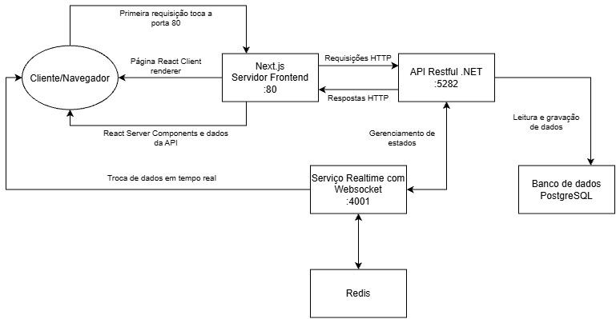

# Codex — MVP

Plataforma de desafios gamificados para estudo, ensino e seleção. Este repositório
contém o **MVP completo**: os três serviços que, juntos, levam uma turma do lobby
ao pódio.

Este README é o guia para colocar o MVP de pé do zero, rodando cada serviço
nativamente. Para subir tudo via Docker Compose, veja [`DOCKER.md`](DOCKER.md).
Cada serviço tem o seu próprio README com as decisões de arquitetura
([`nextjs/README.md`](nextjs/README.md), [`realtime/README.md`](realtime/README.md));
os contratos de API e de WebSocket estão em [`contracts/`](contracts/).

---

## O que o MVP entrega

Uma aula inteira de **Desafios de conhecimento** no formato de fases, roda ponta a ponta pela
interface: criar conjunto de fases → iniciar sala → participante entra pelo código → líder aceita
 entrada de participantes → inicia partida → participantes interagem com o desafio da fase → feedback da interação → comparação com a turma → pódio →
voltar ao lobby para uma outra próxima partida. Cadastro, login, perfil de líder,
histórico de partidas, fila de conjuntos da sala e retomada de sala ativa também
estão dentro do MVP.

**Deliberadamente fora do MVP** (o produto degrada sem quebrar):

| Não entra | Por quê |
|---|---|
| Login OAuth | não iniciado; login por e-mail/senha cobre o fluxo |
| Geração de fase por IA | depende de decisão de provedor; o editor só não mostra o botão |
| Correção de desafios `text` e `code` | mesma decisão de IA — os tipos existem, a correção não |
| `POST /matches/{id}/phases/{id}/run` (executar código) | exige sandbox |
| Modo `self-paced` | responde `409 MODE_NOT_AVAILABLE`; só o modo guiado pelo líder existe |
| Relatórios e CMS da landing | existem como modelo de dados, sem endpoint |

O estado detalhado, rota por rota, está em
[`contracts/api/api-implementation-status.md`](contracts/api/api-implementation-status.md).

---

## Arquitetura



Três regras que explicam a maior parte da configuração abaixo:

1. **O browser nunca fala com a API REST.** Só com o servidor do Next (Server
   Components / Server Actions) e com o WebSocket. Por isso o `API_SERVICE_TOKEN`
   nunca tem prefixo `NEXT_PUBLIC_`.
2. **O realtime não é dono de estado.** Toda mutação passa pela API, que grava e
   publica; o WS só faz fan-out.
3. **Autorização num lugar só.** O token de sessão é opaco (ASP.NET Data
   Protection) e apenas a API o decifra — o realtime pergunta a ela quem é quem.

| Serviço | Pasta | Porta | Stack |
|---|---|---|---|
| API | `.NET/src/Codex.Api` | `5282` (http) / `7091` (https) | .NET 10, Minimal API, EF Core, PostgreSQL |
| Realtime | `realtime` | `4001` (upgrade em `/realtime`) | Node, `ws`, `ioredis` |
| Web | `nextjs` | `3000` | Next.js 15 (App Router, RSC), React 19, CSS Modules |

---

## Pré-requisitos

| Ferramenta | Versão | Observação |
|---|---|---|
| [.NET SDK](https://dotnet.microsoft.com/download) | **10.0** | `TargetFramework` é `net10.0` |
| [Node.js](https://nodejs.org) | **20.12+** | o `start` do realtime usa `--env-file-if-exists` |
| [PostgreSQL](https://www.postgresql.org/download/) | 14+ | obrigatório — a API não sobe sem banco |
| [Redis](https://redis.io/download) | 6+ | **opcional em dev**; sem ele não há eventos de tempo real |
| `dotnet-ef` | 10.x | `dotnet tool install --global dotnet-ef` |

Sobre o Redis: sem ele a API sobe e funciona, mas **nenhum evento é publicado** —
o lobby e a partida param de atualizar sozinhos (é preciso recarregar a página).
O realtime cai para um broker em memória, válido para **uma** instância só. Com
`NODE_ENV=production`, a ausência de `REDIS_URL` vira erro de inicialização.

No Windows, a forma mais rápida de ter os dois:

```powershell
docker run -d --name codex-postgres -e POSTGRES_PASSWORD=postgres -p 5432:5432 postgres:16
docker run -d --name codex-redis -p 6379:6379 redis:7
```

---

## Secrets

Só existem **dois** segredos, e o primeiro é o que mais quebra a instalação.

### 1. Service token — o mesmo valor em três lugares

`x-service-token` prova que a chamada veio do servidor do Next, não de um cliente.
A API **falha fechado**: sem o token configurado ela responde `500
SERVICE_TOKEN_NOT_CONFIGURED` em toda rota que não seja `/health`; com token
errado, `401 INVALID_SERVICE_TOKEN`. O realtime se recusa a subir sem ele.

| Onde | Chave | Como |
|---|---|---|
| API | `CodexApi:ServiceToken` | `dotnet user-secrets` (dev) ou `CodexApi__ServiceToken` (env, em produção) |
| Realtime | `API_SERVICE_TOKEN` | `realtime/.env` |
| Web | `API_SERVICE_TOKEN` | `nextjs/.env.local` |

Gere um valor qualquer, longo e aleatório:

```powershell
[Convert]::ToBase64String((1..32 | ForEach-Object { Get-Random -Max 256 }))
```

**Se os três não baterem, nada funciona:** o handshake do WebSocket responde 401 e
nenhuma tela carrega dados.

### 2. Connection string do PostgreSQL

Só a API precisa. Vai em `ConnectionStrings:Default` (user-secrets em dev,
`ConnectionStrings__Default` em produção). Nunca em `appsettings.json` — o arquivo
versionado a mantém vazia de propósito.

---

## Instalação

### 1. Banco

```powershell
psql -U postgres -c "CREATE DATABASE codex;"
```

### 2. API (.NET)

```powershell
cd .NET\src\Codex.Api

dotnet user-secrets set "ConnectionStrings:Default" "Host=localhost;Port=5432;Database=codex;Username=postgres;Password=postgres"
dotnet user-secrets set "CodexApi:ServiceToken" "<o token gerado acima>"

dotnet restore
dotnet ef database update      # aplica as migrations; a API não migra sozinha no boot
```

O Redis da API já vem apontado para `localhost:6379` em
`appsettings.Development.json`. Em produção, defina
`CodexApi__Realtime__RedisConnectionString` (formato nativo do StackExchange.Redis,
`host:porta` — o realtime usa `redis://host:porta` porque o `ioredis` exige URL;
os dois apontam para o mesmo Redis).

### 3. Realtime (Node)

```powershell
cd realtime
npm install
Copy-Item .env.example .env
```

Edite `realtime\.env` e preencha `API_SERVICE_TOKEN`. Os demais valores do
`.env.example` já servem para desenvolvimento local.

### 4. Web (Next.js)

```powershell
cd nextjs
npm install
Copy-Item .env.example .env.local
```

Edite `nextjs\.env.local`:

```ini
API_BASE_URL=http://localhost:5282   # o .env.example ainda traz :4000/v1, desatualizado
API_SERVICE_TOKEN=<o mesmo token>
NEXT_PUBLIC_REALTIME_URL=ws://localhost:4001/realtime
SESSION_COOKIE_NAME=codex_session
```

`SESSION_COOKIE_NAME` precisa ser **idêntico** nos três lados (`nextjs/.env.local`,
`realtime/.env` e o padrão da API), senão o realtime não encontra a sessão no
handshake.

---

## Rodando

Na raiz do projeto:

```powershell
.\startup.project.bat            # sobe os três, cada um na sua janela de console
.\startup.project.bat /force     # encerra quem estiver ocupando as portas e sobe do zero
```

O script verifica pré-requisitos, roda `npm install` onde faltar `node_modules`,
avisa se `realtime\.env` não existir ou se o Redis estiver fora do ar, e **só sobe
o serviço cuja porta estiver livre** — rodar duas vezes não gera `EADDRINUSE`. Use
`/force` quando um processo órfão de uma execução anterior estiver segurando a
porta com código antigo.

Manualmente, um terminal para cada:

```powershell
cd .NET\src\Codex.Api ; dotnet run --launch-profile http    # http://localhost:5282
cd realtime           ; npm run dev                          # ws://localhost:4001/realtime
cd nextjs             ; npm run dev                          # http://localhost:3000
```

Abra <http://localhost:3000>.

### Conferindo que subiu

```powershell
curl http://localhost:5282/health     # {"status":"ok"} — única rota isenta do service token
curl http://localhost:4001/health
```

A referência OpenAPI da API fica em `http://localhost:5282/openapi/v1.json` (só em
`Development`).

---

## Comandos por projeto

| Projeto | Comando | O que faz |
|---|---|---|
| API | `dotnet run --launch-profile http` | sobe em `:5282` |
| API | `dotnet test` (na pasta `.NET`) | xUnit, banco em memória — não precisa de PostgreSQL nem Redis |
| API | `dotnet ef migrations add <Nome>` | nova migration (rode em `.NET\src\Codex.Api`) |
| Realtime | `npm run dev` | `build` + `start` |
| Realtime | `npm test` | smoke do protocolo contra uma API falsa |
| Realtime | `npm run typecheck` | `tsc --noEmit` |
| Web | `npm run dev` | servidor de desenvolvimento |
| Web | `npm run build` / `npm start` | build e execução de produção |
| Web | `npm run typecheck` | `tsc --noEmit` |

---


## Quando não funcionar

| Sintoma | Causa provável |
|---|---|
| `500 SERVICE_TOKEN_NOT_CONFIGURED` | `CodexApi:ServiceToken` não está nos user-secrets da API |
| `401 INVALID_SERVICE_TOKEN` / toda tela vazia | os três tokens não são idênticos |
| Realtime morre no boot | `API_SERVICE_TOKEN` ausente em `realtime/.env` |
| WebSocket fecha logo após conectar | `REALTIME_ALLOWED_ORIGINS` não inclui `http://localhost:3000`, ou `SESSION_COOKIE_NAME` diverge |
| Telas carregam, mas o lobby não atualiza sozinho | Redis fora do ar — a falha de publicação é engolida de propósito |
| API não sobe / erro de conexão no primeiro request | PostgreSQL fora do ar ou `ConnectionStrings:Default` errada |
| Tabelas não existem | faltou `dotnet ef database update` |
| `EADDRINUSE` no realtime | processo órfão na porta 4001 — `.\startup.project.bat /force` |
| Mudança no código não aparece | o serviço na porta é de uma execução anterior; confira com `curl http://localhost:4001/health` e use `/force` |

---

## Produção

- **Nenhum `.env` é versionado.** Em produção, tudo vira variável de ambiente:
  `CodexApi__ServiceToken`, `ConnectionStrings__Default`,
  `CodexApi__Realtime__RedisConnectionString`.
- **Redis é obrigatório** com mais de uma instância de qualquer um dos dois lados
  (a API publica, o realtime assina). O realtime recusa subir sem `REDIS_URL` em
  `NODE_ENV=production`.
- **O realtime escala horizontalmente sem sticky sessions**: o processo é sem
  estado e cada instância assina só os canais das salas que atende. O porquê está
  em [`realtime/README.md`](realtime/README.md).
- `REALTIME_ALLOWED_ORIGINS` não aceita `*` em produção, e `REALTIME_DEV_PUBLISH`
  é ignorado lá.
