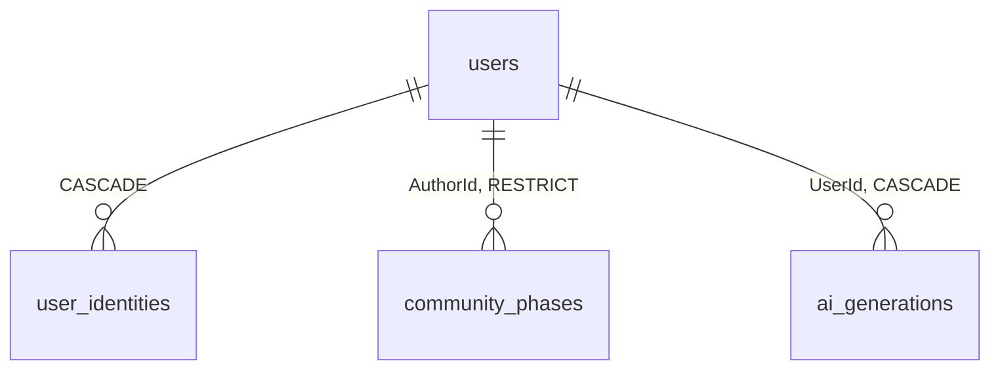

# Contrato de Banco de Dados Relacional (PostgreSQL) — Codex

Este documento define o contrato e a modelagem do banco de dados relacional (PostgreSQL 14+) do Codex. O PostgreSQL atua como fonte autoritativa e durável para **Identidade**, **Contas**, **Chaves de Criptografia de Sessão**, **Geração Assistida por IA** e **Catálogo Global de Desafios da Comunidade (`community_phases`)** (enquanto os conjuntos privados e conjuntos da comunidade residem no MongoDB).

---

## 1. Padrões e Convenções

* **Nomenclatura:** Tabelas em `snake_case` plural; colunas em `PascalCase` com aspas obrigatórias em SQL manual (ex: `users."CreatedAt"`).
* **Chaves Primárias:** `UUID v7` gerados na aplicação (`Guid.CreateVersion7()`), garantindo ordenação cronológica natural por chave primária.
* **Fuso Horário:** Colunas temporais utilizam `timestamptz` (armazenadas em UTC).
* **Enums:** Persistidos como `varchar` com os valores nominais em `PascalCase` (ex: `Teacher`, `Quiz`, `Fill`, `Text`, `Code`, `Published`, `Delisted`).

---

## 2. Diagrama de Relacionamentos do Domínio Principal



---

## 3. Estrutura de Tabelas

### 3.1 Identidade e Contas

#### Tabela `users`
Armazena as contas cadastradas de professores, líderes e recrutadores.
```sql
CREATE TABLE users (
    "Id"           uuid NOT NULL PRIMARY KEY,
    "Name"         varchar(120) NOT NULL,
    "Email"        varchar(256) NOT NULL,
    "PasswordHash" varchar(256) NULL, -- NULL quando a conta é autenticada exclusivamente por OAuth
    "AvatarIndex"  integer NOT NULL DEFAULT 0,
    "Plan"         varchar(32) NOT NULL DEFAULT 'Free',
    "Audience"     varchar(16) NOT NULL DEFAULT 'Teacher',
    "CreatedAt"    timestamptz NOT NULL
);

CREATE UNIQUE INDEX "IX_users_Email" ON users ("Email");
```
* **Valores de `Plan`:** `Free`, `Intermediate`, `Pro`.
* **Valores de `Audience`:** `Teacher`, `Recruiter`.

#### Tabela `user_identities`
Vincula contas de usuários a provedores sociais OAuth externos. Permite relação 1-N (uma conta associada a múltiplos provedores).
```sql
CREATE TABLE user_identities (
    "Id"             uuid NOT NULL PRIMARY KEY,
    "UserId"         uuid NOT NULL REFERENCES users ("Id") ON DELETE CASCADE,
    "Provider"       varchar(16) NOT NULL, -- 'Google', 'Microsoft', 'GitHub'
    "ProviderUserId" varchar(128) NOT NULL, -- Subject ID originado do provedor
    "Email"          varchar(256) NULL,
    "CreatedAt"      timestamptz NOT NULL
);

CREATE UNIQUE INDEX ix_user_identities_provider_subject_unique 
    ON user_identities ("Provider", "ProviderUserId");
CREATE INDEX "IX_user_identities_UserId" ON user_identities ("UserId");
```

#### Tabela `DataProtectionKeys`
Repositório central de anéis de chaves de criptografia do ASP.NET Core Data Protection. Usado para assinar e decifrar os cookies de sessão (`codex_session`) de forma estável entre múltiplos processos da API.
```sql
CREATE TABLE "DataProtectionKeys" (
    "Id"           serial NOT NULL PRIMARY KEY,
    "FriendlyName" text NULL,
    "Xml"          text NULL
);
```

---

### 3.2 Catálogo de Desafios da Comunidade (`community_phases`)

Armazena todos os desafios publicados na comunidade (de forma avulsa ou a partir da publicação de um conjunto). Desafios publicados possuem vida própria: podem ser pesquisados e reutilizados individualmente, e conjuntos publicados na comunidade (armazenados no MongoDB em `community_phase_sets`) apontam para uma lista ordenada de UUIDs dessa tabela via `phaseIds[]`.

Cada registro em `community_phases` é **imutável** após a inserção. Caso o autor edite sua cópia privada e republique, um novo registro é criado (`OriginPhaseId` aponta para o desafio original em caso de remix/derivação; `SourceDraftPhaseId` e `Version` rastreiam a evolução do rascunho do autor).

```sql
CREATE TABLE community_phases (
    "Id"                      uuid NOT NULL PRIMARY KEY,
    "AuthorId"                uuid NOT NULL REFERENCES users ("Id") ON DELETE RESTRICT,
    "AuthorName"              varchar(120) NOT NULL,
    "OriginPhaseId"           uuid NULL,                          -- Desafio de origem em caso de remix (sem FK rígida)
    "SourceDraftPhaseId"      uuid NULL,                          -- ID da fase no rascunho privado do autor (para versionamento)
    "Version"                 integer NOT NULL DEFAULT 1,

    -- Metadados indexáveis para busca avulsa de desafios em escala
    "Kind"                    varchar(16) NOT NULL,               -- 'Quiz', 'Fill', 'Text', 'Code'
    "Subject"                 varchar(64) NOT NULL,               -- Ex: 'Matemática', 'Programação'
    "Difficulty"              varchar(16) NULL,                   -- 'Easy', 'Medium', 'Hard'
    "Name"                    varchar(160) NOT NULL,
    "QuestionPreview"         varchar(300) NOT NULL,              -- Trecho inicial do enunciado para listagem rápida
    "BasePoints"              integer NOT NULL,
    "PointsMultiplier"        numeric(5,2) NOT NULL DEFAULT 1.00,
    "TimeSeconds"             integer NOT NULL,

    -- Payload completo e imutável do desafio
    "ContentJson"             jsonb NOT NULL,
    "ContentHash"             varchar(64) NOT NULL,               -- SHA-256 canônico (evita duplicatas idênticas na publicação)

    -- Estado e métricas acumuladas
    "Status"                  varchar(16) NOT NULL DEFAULT 'Published', -- 'Published', 'Delisted'
    "UseCount"                bigint NOT NULL DEFAULT 0,
    "SubmissionsCount"        bigint NOT NULL DEFAULT 0,
    "CorrectSubmissionsCount" bigint NOT NULL DEFAULT 0,
    "PublishedAt"             timestamptz NOT NULL
);

-- Busca no catálogo da comunidade por Disciplina + Tipo + Popularidade
CREATE INDEX "IX_community_phases_Catalog_Popular"
    ON community_phases ("Status", "Subject", "Kind", "UseCount" DESC);

-- Busca no catálogo da comunidade por Disciplina + Tipo + Recência
CREATE INDEX "IX_community_phases_Catalog_Recent"
    ON community_phases ("Status", "Subject", "Kind", "PublishedAt" DESC);

-- Desafios publicados por um autor específico
CREATE INDEX "IX_community_phases_AuthorId_PublishedAt"
    ON community_phases ("AuthorId", "PublishedAt" DESC);

-- Índice Full-Text Search (GIN) em Português para pesquisar desafios em escala sem Full Table Scan
CREATE INDEX "IX_community_phases_Search_Gin"
    ON community_phases
    USING gin (to_tsvector('portuguese', "Name" || ' ' || "QuestionPreview"));
```

#### 3.2.1 Estratégia de Escalonamento e Lookup por Conjunto (`ANY(@phaseIds)`)
Os conjuntos da comunidade no MongoDB (`community_phase_sets`) armazenam um vetor ordenado `phaseIds[]` com até 50 UUIDs. Ao abrir, copiar ou enfileirar um conjunto da comunidade na sala, a API resolve todos os desafios em uma única consulta por chave primária:
```sql
SELECT *
FROM community_phases
WHERE "Id" = ANY(@phaseIds);
```
O PostgreSQL executa $K \le 50$ buscas diretas na árvore B-Tree da chave primária (`$O(K \log N)$`), levando aproximadamente **1 ms** mesmo em tabelas com dezenas de milhões de desafios, sem varredura sequencial (*Full Table Scan*) e mantendo a ordem original do vetor `phaseIds[]` na camada de aplicação.

---

### 3.3 Geração Assistida por IA (`ai_generations`)

Registra as solicitações de geração por IA para controle de cota mensal por plano, limite diário de sugestões e histórico de perguntas aceitas.

```sql
CREATE TABLE ai_generations (
    "Id"               uuid NOT NULL PRIMARY KEY,
    "UserId"           uuid NOT NULL REFERENCES users ("Id") ON DELETE CASCADE,
    "Operation"        varchar(24) NOT NULL, -- 'Phase', 'Variations', 'QuizOptions'
    "Kind"             varchar(16) NULL,     -- 'Quiz', 'Fill', 'Text', 'Code'
    "Provider"         varchar(32) NOT NULL,
    "Model"            varchar(80) NOT NULL,
    "Status"           varchar(16) NOT NULL, -- 'Pending', 'Succeeded', 'Failed'
    "Decision"         varchar(16) NOT NULL DEFAULT 'Undecided', -- 'Undecided', 'Accepted', 'Partial', 'Discarded'
    "Cost"             integer NOT NULL DEFAULT 0,
    "InputJson"        jsonb NOT NULL,
    "OutputJson"       jsonb NULL,
    "PromptTokens"     integer NULL,
    "CompletionTokens" integer NULL,
    "LatencyMs"        integer NULL,
    "ErrorCode"        varchar(48) NULL,
    "CreatedAt"        timestamptz NOT NULL,
    "DecidedAt"        timestamptz NULL
);

CREATE INDEX "IX_ai_generations_UserId_CreatedAt" ON ai_generations ("UserId", "CreatedAt");
CREATE INDEX "IX_ai_generations_UserId_Operation_CreatedAt" ON ai_generations ("UserId", "Operation", "CreatedAt");
```

---

## 4. Estrutura do Campo `ContentJson` (`jsonb`)

O campo `ContentJson` é tipado em tempo de execução e armazena a forma completa de autoria. Todas as variantes compartilham obrigatoriamente os atributos `question` e `fromAI`, além dos metadados opcionais de apresentação e autoria (`theme`, `showFeedbackAnimation`, `introSeconds`, `introTip`, `introSound`, `introShapes`, `variationSettings`).

### 4.1 Formato Quiz
```json
{
  "question": "Quanto é 1 + 2?",
  "fromAI": false,
  "options": ["3", "2", "1", "4"],
  "correctIndexes": [0]
}
```
* `options`: 2 a 8 itens.
* `correctIndexes`: array não-vazio de números correspondentes às alternativas corretas.

### 4.2 Formato Completar Frase (`Fill`)
```json
{
  "question": "Uma fração equivalente mantém a ___ entre numerador e denominador.",
  "fromAI": false,
  "words": ["razão", "soma", "divisão", "multiplicação"],
  "blanks": ["razão"]
}
```
* `blanks`: array posicional ordenado segundo as marcações `___` da pergunta.
* `words`: banco global de opções para seleção do jogador (inclui distratores).

### 4.3 Formato Dissertativa (`Text`)
```json
{
  "question": "Cite os 3 primeiros números primos.",
  "fromAI": false,
  "expectedAnswer": "2, 3, 5"
}
```

### 4.4 Formato Código (`Code`)
```json
{
  "question": "Implemente uma função que retorne 1 para ímpares e 0 para pares.",
  "fromAI": false,
  "starterCode": "function solucao(entrada) {\n  \n}\n",
  "testCases": "Entrada: 10\nSaída: 0\nEntrada: 7\nSaída: 1"
}
```

---

## 5. Regras de Integridade e Restrições de Armazenamento

1. **Limites de Tamanho de Campo:**
   * Enunciados (`question`): Máximo de 4.000 caracteres.
   * Código Inicial (`starterCode`): Máximo de 8.000 caracteres.
   * Casos de Teste (`testCases`): Máximo de 8.000 caracteres.
   * Título de Conjunto: Máximo de 160 caracteres.
2. **Desacoplamento de Linhagem:** Chaves que apontam para origens de clonagem ou rascunho (`OriginPhaseId`, `SourceDraftPhaseId`) **não utilizam constraints de Foreign Key (FK)**. Dessa forma, a exclusão de um conjunto privado pelo autor não corrompe nem remove em cascata desafios publicados ou derivados na comunidade.
3. **Imutabilidade e Deduplicação em `community_phases`:** O conteúdo de uma linha em `community_phases` (`Kind`, `Name`, `BasePoints`, `PointsMultiplier`, `TimeSeconds`, `ContentJson`, `ContentHash`) é estritamente imutável após inserção. Atualizações de pontuação e estatísticas da comunidade afetam exclusivamente `UseCount`, `SubmissionsCount`, `CorrectSubmissionsCount` e `Status`. O campo `ContentHash` armazena o SHA-256 canônico do desafio para evitar duplicação na publicação quando uma fase importada não foi modificada.
