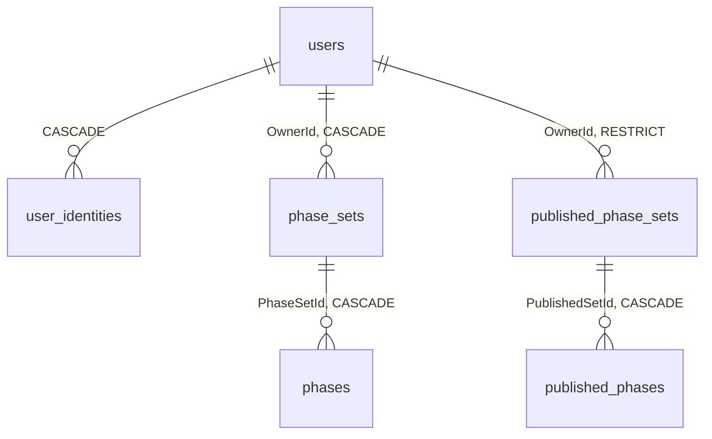

# Contrato de Banco de Dados Relacional (PostgreSQL) — Codex

Este documento define o contrato e a modelagem do banco de dados relacional (PostgreSQL 14+) do Codex. O PostgreSQL atua como fonte autoritativa e durável para **Identidade**, **Contas**, **Chaves de Criptografia de Sessão** e **Material Didático do Autor (Catálogo e Conjuntos de Fases)**.

---

## 1. Padrões e Convenções

* **Nomenclatura:** Tabelas em `snake_case` plural; colunas em `PascalCase` com aspas obrigatórias em SQL manual (ex: `users."CreatedAt"`).
* **Chaves Primárias:** `UUID v7` gerados na aplicação (`Guid.CreateVersion7()`), garantindo ordenação cronológica natural por chave primária.
* **Fuso Horário:** Colunas temporais utilizam `timestamptz` (armazenadas em UTC).
* **Enums:** Persistidos como `varchar` com os valores nominais em `PascalCase` (ex: `Teacher`, `Private`, `Quiz`, `Fill`, `Text`, `Code`).

---

## 2. Diagrama de Relacionamentos do Domínio Principal



---

## 3. Estrutura de Tabelas

### 3.1 Identidade e Contas

#### Tabela `users`
Armazena as contas cadastradas de professores, líderes e recrutadores.
```sql
CREATE TABLE users (
    "Id"           uuid NOT NULL PRIMARY KEY,
    "Name"         varchar(120) NOT NULL,
    "Email"        varchar(256) NOT NULL,
    "PasswordHash" varchar(256) NULL, -- NULL quando a conta é autenticada exclusivamente por OAuth
    "AvatarIndex"  integer NOT NULL DEFAULT 0,
    "Plan"         varchar(32) NOT NULL DEFAULT 'Free',
    "Audience"     varchar(16) NOT NULL DEFAULT 'Teacher',
    "CreatedAt"    timestamptz NOT NULL
);

CREATE UNIQUE INDEX "IX_users_Email" ON users ("Email");
```
* **Valores de `Plan`:** `Free`, `Intermediate`, `Pro`.
* **Valores de `Audience`:** `Teacher`, `Recruiter`.

#### Tabela `user_identities`
Vincula contas de usuários a provedores sociais OAuth externos. Permite relação 1-N (uma conta associada a múltiplos provedores).
```sql
CREATE TABLE user_identities (
    "Id"             uuid NOT NULL PRIMARY KEY,
    "UserId"         uuid NOT NULL REFERENCES users ("Id") ON DELETE CASCADE,
    "Provider"       varchar(16) NOT NULL, -- 'Google', 'Microsoft', 'GitHub'
    "ProviderUserId" varchar(128) NOT NULL, -- Subject ID originado do provedor
    "Email"          varchar(256) NULL,
    "CreatedAt"      timestamptz NOT NULL
);

CREATE UNIQUE INDEX ix_user_identities_provider_subject_unique 
    ON user_identities ("Provider", "ProviderUserId");
CREATE INDEX "IX_user_identities_UserId" ON user_identities ("UserId");
```

#### Tabela `DataProtectionKeys`
Repositório central de anéis de chaves de criptografia do ASP.NET Core Data Protection. Usado para assinar e decifrar os cookies de sessão (`codex_session`) de forma estável entre múltiplos processos da API.
```sql
CREATE TABLE "DataProtectionKeys" (
    "Id"           serial NOT NULL PRIMARY KEY,
    "FriendlyName" text NULL,
    "Xml"          text NULL
);
```

---

### 3.2 Material Didático (Rascunhos e Autoria)

#### Tabela `phase_sets`
Conjuntos de desafios criados por um autor.
```sql
CREATE TABLE phase_sets (
    "Id"         uuid NOT NULL PRIMARY KEY,
    "Title"      varchar(160) NOT NULL,
    "OwnerId"    uuid NOT NULL REFERENCES users ("Id") ON DELETE CASCADE,
    "Visibility" varchar(16) NOT NULL DEFAULT 'Private', -- 'Private', 'Community'
    "CreatedAt"  timestamptz NOT NULL,
    "UpdatedAt"  timestamptz NOT NULL
);

CREATE INDEX "IX_phase_sets_OwnerId_UpdatedAt" ON phase_sets ("OwnerId", "UpdatedAt");
CREATE INDEX "IX_phase_sets_Visibility_Title" ON phase_sets ("Visibility", "Title");
```

#### Tabela `phases`
Fases individuais vinculadas a um conjunto. O conteúdo de autoria é mantido em formato JSON.
```sql
CREATE TABLE phases (
    "Id"               uuid NOT NULL PRIMARY KEY,
    "PhaseSetId"       uuid NOT NULL REFERENCES phase_sets ("Id") ON DELETE CASCADE,
    "Kind"             varchar(16) NOT NULL, -- 'Quiz', 'Fill', 'Text', 'Code'
    "Name"             varchar(160) NOT NULL,
    "BasePoints"       integer NOT NULL,
    "PointsMultiplier" numeric(5,2) NOT NULL DEFAULT 1.00,
    "TimeSeconds"      integer NOT NULL,
    "OrderIndex"       integer NOT NULL,
    "ContentJson"      jsonb NOT NULL
);

CREATE INDEX "IX_phases_PhaseSetId_OrderIndex" ON phases ("PhaseSetId", "OrderIndex");
```

---

### 3.3 Catálogo da Comunidade (Versões Imutáveis)

Conjuntos publicados na comunidade tornam-se registros imutáveis. Cada alteração cria uma versão subsequente (`Version = N + 1`), garantindo que métricas de uso e salas antigas mantenham referência fiel ao conteúdo exato utilizado.

#### Tabela `published_phase_sets`
```sql
CREATE TABLE published_phase_sets (
    "Id"                      uuid NOT NULL PRIMARY KEY,
    "SourceSetId"             uuid NOT NULL, -- Identificador de origem no rascunho (sem FK para preservar integridade histórica)
    "Version"                 integer NOT NULL DEFAULT 1,
    "OwnerId"                 uuid NOT NULL REFERENCES users ("Id") ON DELETE RESTRICT,
    "Title"                   varchar(160) NOT NULL,
    "Permission"              varchar(16) NOT NULL DEFAULT 'Closed', -- 'Closed', 'Remixable'
    "Status"                  varchar(16) NOT NULL DEFAULT 'Published', -- 'Published', 'Delisted'
    "PublishedAt"             timestamptz NOT NULL,
    "CountersUpdatedAt"       timestamptz NOT NULL,
    "Approvals"               integer NOT NULL DEFAULT 0,
    "Rejections"              integer NOT NULL DEFAULT 0,
    "SubmissionsCount"        bigint NOT NULL DEFAULT 0,
    "CorrectSubmissionsCount" bigint NOT NULL DEFAULT 0
);

CREATE UNIQUE INDEX ix_published_phase_sets_source_version 
    ON published_phase_sets ("SourceSetId", "Version");
```

#### Tabela `published_phases`
```sql
CREATE TABLE published_phases (
    "Id"                      uuid NOT NULL PRIMARY KEY,
    "PublishedSetId"          uuid NOT NULL REFERENCES published_phase_sets ("Id") ON DELETE CASCADE,
    "OriginPublishedPhaseId"  uuid NULL, -- Identificador da fase mãe em caso de remix
    "Kind"                    varchar(16) NOT NULL,
    "Name"                    varchar(160) NOT NULL,
    "BasePoints"              integer NOT NULL,
    "PointsMultiplier"        numeric(5,2) NOT NULL DEFAULT 1.00,
    "TimeSeconds"             integer NOT NULL,
    "OrderIndex"              integer NOT NULL,
    "ContentJson"             jsonb NOT NULL,
    "SubmissionsCount"        bigint NOT NULL DEFAULT 0,
    "CorrectSubmissionsCount" bigint NOT NULL DEFAULT 0
);

CREATE INDEX "IX_published_phases_Set_Order" ON published_phases ("PublishedSetId", "OrderIndex");
```

---

## 4. Estrutura do Campo `ContentJson` (`jsonb`)

O campo `ContentJson` é tipado em tempo de execução e armazena a forma completa de autoria. Todas as variantes compartilham obrigatoriamente os atributos `question` e `fromAI`.

### 4.1 Formato Quiz
```json
{
  "question": "Quanto é 1 + 2?",
  "fromAI": false,
  "options": ["3", "2", "1", "4"],
  "correctIndexes": [0]
}
```
* `options`: 2 a 6 itens.
* `correctIndexes`: array não-vazio de números correspondentes às alternativas corretas.

### 4.2 Formato Completar Frase (`Fill`)
```json
{
  "question": "Uma fração equivalente mantém a ___ entre numerador e denominador.",
  "fromAI": false,
  "words": ["razão", "soma", "divisão", "multiplicação"],
  "blanks": ["razão"]
}
```
* `blanks`: array posicional ordenado segundo as marcações `___` da pergunta.
* `words`: banco global de opções para seleção do jogador (inclui distratores).

### 4.3 Formato Dissertativa (`Text`)
```json
{
  "question": "Cite os 3 primeiros números primos.",
  "fromAI": false,
  "expectedAnswer": "2, 3, 5"
}
```

### 4.4 Formato Código (`Code`)
```json
{
  "question": "Implemente uma função que retorne 1 para ímpares e 0 para pares.",
  "fromAI": false,
  "starterCode": "function solucao(entrada) {\n  \n}\n",
  "testCases": "Entrada: 10\nSaída: 0\nEntrada: 7\nSaída: 1"
}
```

---

## 5. Regras de Integridade e Restrições de Armazenamento

1. **Limites de Tamanho de Campo:**
   * Enunciados (`question`): Máximo de 4.000 caracteres.
   * Código Inicial (`starterCode`): Máximo de 8.000 caracteres.
   * Casos de Teste (`testCases`): Máximo de 8.000 caracteres.
   * Título de Conjunto: Máximo de 160 caracteres.
2. **Desacoplamento de Linhagem:** Chaves que apontam para origens de clonagem ou rascunho (`SourceSetId`, `OriginPublishedPhaseId`) **não utilizam constraints de Foreign Key (FK)**. Dessa forma, a exclusão de um conjunto original pelo autor não corrompe nem remove em cascata conteúdos publicados ou derivados.
3. **Imutabilidade de Versões:** Em `published_phase_sets`, o conteúdo da fase é imutável após inserção. Atualizações de pontuação da comunidade afetam exclusivamente `SubmissionsCount`, `CorrectSubmissionsCount`, `Approvals`, `Rejections` e `CountersUpdatedAt`.
