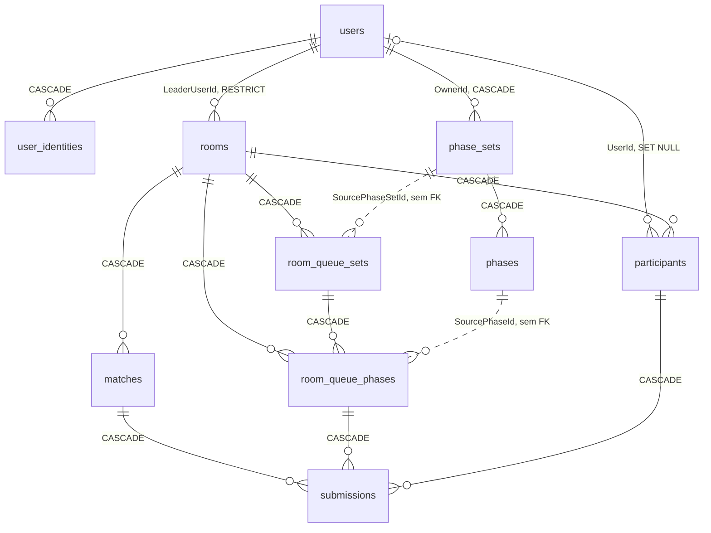

# Codex — como os dados estão armazenados hoje

Retrato do banco **como ele está**, não como deveria estar. Serve de base para decidir o que
mexer antes de mexer.

- **Fonte:** Postgres 18.4 nativo do host (`localhost:5432`, database `codex`) — o container
  `postgres` do compose está parado; o que roda em dev é o nativo.
- **Snapshot:** 2026-09-17. Schema extraído com `pg_dump --schema-only`, linhas com `psql -x`.
- **Migration mais recente aplicada:** `20260908234747_UserIdentities` (7 de 7).
- **PII mascarado:** nome, e-mail, hash de senha e `ProviderUserId` aparecem ofuscados.
  Todo o resto — UUIDs, códigos de sala, timestamps e **todos os payloads `jsonb`** — é literal.

> ⚠️ `docs/contracts/postgresql/modelagem_codex.sql` está **uma migration atrasado**: não tem
> `user_identities`. O DDL deste documento veio do banco ao vivo.

---

## 1. Inventário

12 tabelas: 10 de domínio + 2 de infraestrutura.

| Tabela | Linhas | O que guarda |
|---|---:|---|
| `users` | 5 | Conta (professor/recrutador). Dono de conjuntos e líder de salas. |
| `user_identities` | 3 | Vínculo OAuth (Google/Microsoft/GitHub) → `users`. N por usuário. |
| `phase_sets` | 6 | Conjunto de fases autorado. O "material didático". |
| `phases` | 9 | Fase dentro de um conjunto. Conteúdo real fica em `ContentJson`. |
| `rooms` | 4 | Sala com código de 6 dígitos. |
| `participants` | 3 | Quem entrou na sala (com ou sem conta). |
| `room_queue_sets` | 3 | **Cópia** de um conjunto no momento de montar a fila da sala. |
| `room_queue_phases` | 9 | **Cópia** das fases, gabarito incluído. É o que a partida executa. |
| `matches` | 7 | Execução da fila. Uma sala pode rodar várias partidas. |
| `submissions` | 9 | Resposta de um participante numa fase de uma partida. |
| `DataProtectionKeys` | 1 | Key ring do ASP.NET Data Protection (assina o cookie de sessão). |
| `__EFMigrationsHistory` | 7 | Controle do EF Core. |

Convenção: **tabelas em snake_case, colunas em PascalCase** (`users."CreatedAt"`). Consequência
prática: toda query manual precisa de aspas duplas nas colunas.

Chaves primárias são **UUID v7** gerados na aplicação (`Guid.CreateVersion7()`), não no banco —
por isso os ids do dump são ordenáveis por tempo (`01a069ee…` < `01a0b0c0…`).

### Relacionamentos



Três coisas que o diagrama esconde e importam:

1. **`rooms → users` é RESTRICT**, não Cascade. Apagar um usuário que já criou sala falha.
   Todas as outras FKs para `users` são Cascade (`phase_sets`, `user_identities`) ou
   SET NULL (`participants`).
2. **As setas pontilhadas não são FK nenhuma.** `room_queue_sets.SourcePhaseSetId` e
   `room_queue_phases.SourcePhaseId` guardam linhagem, não referência — de propósito, para
   que apagar o conjunto original não apague a sala que já o copiou. Ficam órfãos por design.
3. **`matches` não referencia fase alguma.** `matches.CurrentPhaseIndex` é um `int` que casa
   com `room_queue_phases.OrderIndex`, sem FK.

---

## 2. Tabela por tabela

### `users`

| Coluna | Tipo | Notas |
|---|---|---|
| `Id` | `uuid` | PK, UUID v7 da aplicação |
| `Name` | `varchar(120)` | |
| `Email` | `varchar(256)` | **UNIQUE** (`IX_users_Email`, nome fixado no código porque a violação vira `EMAIL_TAKEN`) |
| `PasswordHash` | `varchar(256)` NULL | **NULL = conta só-OAuth** |
| `AvatarIndex` | `integer` | |
| `Plan` | `varchar(32)` | enum como string |
| `Audience` | `varchar(16)` | default `'Teacher'` |
| `CreatedAt` | `timestamptz` | |

```
Id           | 01a069ee-9029-76e7-b874-9508fa1a2f13
Name         | V***
Email        | ***@gmail.com
PasswordHash | <hash>
AvatarIndex  | 0
Plan         | Free
CreatedAt    | 2026-09-03 22:00:37.289867-03
Audience     | Teacher

Id           | 01a083a7-a8a0-7023-8a9d-1b72f3fc079a
Name         | V***
Email        | ***@gmail.com
PasswordHash | (null)          <- conta criada por OAuth, nunca teve senha
AvatarIndex  | 0
Plan         | Free
CreatedAt    | 2026-09-08 21:53:18.11223-03
Audience     | Teacher
```

Nos 5 registros reais: `Plan` é `Free`, `Audience` é `Teacher` e `AvatarIndex` é `0` em **todos**
— nenhuma dessas três colunas tem variação no banco. 2 das 5 contas têm `PasswordHash` nulo
(vieram de OAuth).

### `user_identities`

| Coluna | Tipo | Notas |
|---|---|---|
| `Id` | `uuid` | PK |
| `UserId` | `uuid` | FK → `users`, CASCADE |
| `Provider` | `varchar(16)` | `Google` / `Microsoft` / `GitHub` |
| `ProviderUserId` | `varchar(128)` | o `sub` do provedor |
| `Email` | `varchar(256)` NULL | e-mail **no provedor**, pode divergir de `users.Email` |
| `CreatedAt` | `timestamptz` | |

Índices: `ix_user_identities_provider_subject_unique` UNIQUE em `(Provider, ProviderUserId)`;
`IX_user_identities_UserId`.

```
Id             | 01a083a7-a8f1-7978-82ae-18831a7994f5
UserId         | 01a083a7-a8a0-7023-8a9d-1b72f3fc079a
Provider       | Google
ProviderUserId | 1003…3175
Email          | ***@gmail.com
CreatedAt      | 2026-09-08 21:53:18.193452-03

Id             | 01a08459-6d29-71a2-b0ae-25a483461dab
UserId         | 01a08459-6ce8-71e7-94aa-beffc8d026f5
Provider       | Microsoft
ProviderUserId | AAAA…Eqao
Email          | ***@gmail.com
CreatedAt      | 2026-09-09 01:07:28.297603-03

Id             | 01a086c7-f92b-792b-8ba5-a309d8f86274
UserId         | 01a08459-6ce8-71e7-94aa-beffc8d026f5    <- mesmo usuário da linha acima
Provider       | Google
ProviderUserId | 1129…5180
Email          | ***@gmail.com
CreatedAt      | 2026-09-09 12:27:27.531586-03
```

O caso interessante já está nos dados: um mesmo `UserId` com **duas** identidades (Microsoft +
Google). É a relação 1-N funcionando — a mesma pessoa entrando por dois provedores.

### `phase_sets`

| Coluna | Tipo | Notas |
|---|---|---|
| `Id` | `uuid` | PK |
| `Title` | `varchar(160)` | |
| `OwnerId` | `uuid` | FK → `users`, CASCADE |
| `Visibility` | `varchar(16)` | `Private` / `Community` |
| `CreatedAt` / `UpdatedAt` | `timestamptz` | |

Índices: `(OwnerId, UpdatedAt)`, `(Visibility, Title)`.

```
Id         | 01a069f5-8351-7c3f-aa88-50364832e5c1
Title      | Conjunto de exemplo
OwnerId    | 01a069ee-9029-76e7-b874-9508fa1a2f13
Visibility | Private
CreatedAt  | 2026-09-03 22:08:12.753465-03
UpdatedAt  | 2026-09-03 22:08:12.753465-03

Id         | 01a08418-69c6-70e0-8115-69c90db12f4c
Title      | Teste
OwnerId    | 01a083a7-a8a0-7023-8a9d-1b72f3fc079a
Visibility | Private
CreatedAt  | 2026-09-08 23:56:27.590517-03
UpdatedAt  | 2026-09-10 12:06:46.213119-03    <- único com UpdatedAt != CreatedAt
```

Os 6 registros são `Private`. Só o "Conjunto de exemplo" tem 4 fases; os outros 5 (`Teste`, `awd`,
`dwadw`, `dawdaw`, `adwda`) têm **uma fase cada**, e quatro deles são claramente lixo de teste —
vale saber antes de tirar qualquer média de "fases por conjunto".

### `phases`

| Coluna | Tipo | Notas |
|---|---|---|
| `Id` | `uuid` | PK |
| `PhaseSetId` | `uuid` | FK → `phase_sets`, CASCADE |
| `Kind` | `varchar(16)` | `Quiz` / `Fill` / `Text` / `Code` |
| `Name` | `varchar(160)` | |
| `BasePoints` | `integer` | |
| `PointsMultiplier` | `numeric(5,2)` | |
| `TimeSeconds` | `integer` | |
| `OrderIndex` | `integer` | posição na lista, 0-based |
| `ContentJson` | `jsonb` | **todo o conteúdo da fase** — ver seção 4 |

Índice: `(PhaseSetId, OrderIndex)`.

```
Id               | 01a069f5-835e-73d4-9f5d-b86c84c20733
PhaseSetId       | 01a069f5-8351-7c3f-aa88-50364832e5c1
Kind             | Quiz
Name             | Pergunta fácil de soma
BasePoints       | 50
PointsMultiplier | 1.00
TimeSeconds      | 15
OrderIndex       | 0
ContentJson      | {"fromAI": false, "options": ["3", "2", "1", "4"], "question": "Quanto é 1 + 2?", "correctIndexes": [0]}

Id               | 01a069f5-8376-7626-b2ed-6463f70de3e9
PhaseSetId       | 01a069f5-8351-7c3f-aa88-50364832e5c1
Kind             | Code
Name             | É par ou ímpar?
BasePoints       | 100
PointsMultiplier | 1.50
TimeSeconds      | 90
OrderIndex       | 1
ContentJson      | {"fromAI": false, "question": "Faça um algoritmo que retorne 0 caso o número de entrada seja par, e retorne 1 caso o número de entrada seja ímpar.", "testCases": "Entrada: 10\nSaída: 0", "starterCode": "function solucao(entrada) {\n  \n}\n"}
```

O conjunto `01a069f5-8351-…` ("Conjunto de exemplo") é o único com as **quatro** variações de
`Kind` — é a amostra boa. Os outros 5 conjuntos têm só `Quiz`.

### `rooms`

| Coluna | Tipo | Notas |
|---|---|---|
| `Id` | `uuid` | PK |
| `Code` | `varchar(6)` | índice **NÃO-único de propósito** — códigos são reciclados na expiração |
| `Status` | `varchar(16)` | `Lobby` / `Running` / `Finished` |
| `MatchMode` | `varchar(16)` NULL | NULL enquanto nenhuma partida começou |
| `Capacity` | `integer` | |
| `Locked` / `RequireAccount` | `boolean` | |
| `LeaderUserId` | `uuid` | FK → `users`, **RESTRICT** |
| `CreatedAt` | `timestamptz` | |
| `ExpiresAt` | `timestamptz` NULL | |
| `QueueRevision` | `integer` | default 0; sobe a cada mutação da fila, alimenta `queue.updated` |

```
Id             | 01a06cc4-7b7f-7025-ba5d-98a2c92dfbb6
Code           | 969180
Status         | Running
MatchMode      | Live
Capacity       | 20
Locked         | f
RequireAccount | f
LeaderUserId   | 01a069ee-9029-76e7-b874-9508fa1a2f13
CreatedAt      | 2026-09-04 11:13:31.135642-03
ExpiresAt      | 2026-09-05 11:14:26.629643-03
QueueRevision  | 0

Id             | 01a0b0bb-c4e4-7927-b62f-29a0d1928656
Code           | 028328
Status         | Lobby
MatchMode      | (null)
Capacity       | 20
Locked         | f
RequireAccount | f
LeaderUserId   | 01a083a7-a8a0-7023-8a9d-1b72f3fc079a
CreatedAt      | 2026-09-17 15:58:10.788696-03
ExpiresAt      | (null)
QueueRevision  | 0
```

Duas incoerências reais, visíveis nos dados:

- A sala `969180` está `Status = Running` com `ExpiresAt` no passado (2026-09-05) e suas duas
  partidas já `Finished`. **Não existe job de limpeza** — ela segura o código para sempre.
- A sala `618531` está `Status = Lobby` com 4 partidas `Finished` associadas — e é o caminho
  normal, não corrupção: `MatchService.ReturnToLobbyAsync` devolve a sala ao lobby ao encerrar a
  partida, zerando `MatchMode` e `ExpiresAt` e deixando o histórico de `matches` intacto.
  A diferença entre as duas salas é só essa: `969180` foi abandonada no meio, `618531` foi
  encerrada pelo líder 4 vezes.

`QueueRevision` é `0` nas 4 salas, embora 3 delas tenham fila montada. É esperado: o contador sobe
em `RoomQueueService.SaveAndPublishAsync`, que só roda nas rotas de mutação da fila. A montagem
inicial (`POST /rooms`) passa por `AppendSetAsync`, que entra na mesma transação da criação da sala
e **não** incrementa. Ou seja, `QueueRevision = 0` significa "fila nunca editada depois de criada",
não "sala sem fila".

### `participants`

| Coluna | Tipo | Notas |
|---|---|---|
| `Id` | `uuid` | PK |
| `RoomId` | `uuid` | FK → `rooms`, CASCADE |
| `DisplayName` | `varchar(80)` | |
| `DisplayNameNormalized` | `text` | **coluna computada STORED**: `lower("DisplayName")` |
| `AvatarIndex` | `integer` | |
| `LoggedIn` | `boolean` | |
| `UserId` | `uuid` NULL | FK → `users`, **SET NULL**. NULL = convidado sem conta |
| `Status` | `varchar(16)` | `Pending` / `Approved` / `Rejected` |
| `JoinedAt` | `timestamptz` | |
| `InResultsSince` | `timestamptz` NULL | não-nulo = está no pódio, não no lobby |

Índices: `(RoomId, Status, JoinedAt)`; `(UserId)`; e o parcial

```sql
CREATE UNIQUE INDEX ix_participants_room_display_name_unique
  ON participants ("RoomId", "DisplayNameNormalized")
  WHERE "Status" <> 'Rejected';
```

O `WHERE` é o ponto: um nome recusado libera o apelido de volta para a sala.

```
Id                    | 01a06cc4-a5bc-74a1-8a5d-3a443f5f3e59
RoomId                | 01a06cc4-7b7f-7025-ba5d-98a2c92dfbb6
DisplayName           | Maria
AvatarIndex           | 1
LoggedIn              | t
UserId                | 01a069f6-56b0-764c-852e-ec5787df5837
Status                | Approved
JoinedAt              | 2026-09-04 11:13:41.948551-03
DisplayNameNormalized | maria
InResultsSince        | 2026-09-04 11:14:26.629643-03

Id                    | 01a09174-7f3c-76d6-9bd5-36aa9ca100df
RoomId                | 01a08d6f-cec0-7520-ab2e-4b6340fd4ee4
DisplayName           | Edge
AvatarIndex           | 0
LoggedIn              | f
UserId                | (null)          <- convidado, sem conta
Status                | Approved
JoinedAt              | 2026-09-11 14:12:06.204918-03
DisplayNameNormalized | edge
InResultsSince        | (null)
```

Há duas linhas `DisplayName = 'Edge'` — em **salas diferentes**, então o índice parcial não é
violado. O mesmo apelido em duas salas é legítimo.

### `room_queue_sets`

Cópia do `phase_set` no momento em que o líder monta a fila.

| Coluna | Tipo | Notas |
|---|---|---|
| `Id` | `uuid` | PK |
| `RoomId` | `uuid` | FK → `rooms`, CASCADE |
| `SourcePhaseSetId` | `uuid` | **sem FK** — linhagem |
| `Title` | `varchar(160)` | copiado |
| `Color` | `varchar(32)` | token CSS |
| `OrderIndex` | `integer` | |

```
Id               | 01a06a04-380f-737c-b7c7-9f5363bed6ef
RoomId           | 01a06a04-37e5-736b-bc77-6ad77b06cfbd
SourcePhaseSetId | 01a069f5-8351-7c3f-aa88-50364832e5c1
Title            | Conjunto de exemplo
Color            | var(--blue-500)
OrderIndex       | 0
```

`Color` guarda o token CSS **literal** (`var(--blue-500)`) — o banco conhece nome de variável do
front. Nas 3 linhas, é `var(--blue-500)` em todas.

### `room_queue_phases`

Mesmas colunas de `phases`, mais `RoomId`, `RoomQueueSetId` e `SourcePhaseId`. **É esta tabela que
a partida executa**, não `phases`.

```
Id               | 01a06a04-382d-7d15-a238-05c55b0570f0
RoomId           | 01a06a04-37e5-736b-bc77-6ad77b06cfbd
RoomQueueSetId   | 01a06a04-380f-737c-b7c7-9f5363bed6ef
SourcePhaseId    | 01a069f5-835e-73d4-9f5d-b86c84c20733
Kind             | Quiz
Name             | Pergunta fácil de soma
BasePoints       | 50
PointsMultiplier | 1.00
TimeSeconds      | 15
OrderIndex       | 0
ContentJson      | {"fromAI": false, "options": ["3", "2", "1", "4"], "question": "Quanto é 1 + 2?", "correctIndexes": [0]}
```

Índices: `(RoomId, OrderIndex)`, `(RoomQueueSetId)`. Ver seção 5 sobre a duplicação.

### `matches`

| Coluna | Tipo | Notas |
|---|---|---|
| `Id` | `uuid` | PK |
| `RoomId` | `uuid` | FK → `rooms`, CASCADE |
| `Mode` | `varchar(16)` | `Live` / `SelfPaced` |
| `Status` | `varchar(16)` | `Running` / `Paused` / `Finished` |
| `CurrentPhaseIndex` | `integer` | casa com `room_queue_phases.OrderIndex`, **sem FK** |
| `StartedAt` | `timestamptz` | |
| `FinishedAt` | `timestamptz` NULL | |
| `CurrentPhaseStartedAt` | `timestamptz` NULL | |
| `CurrentPhaseEndsAt` | `timestamptz` NULL | NULL ⇒ pausada |
| `CurrentPhaseEndedAt` | `timestamptz` NULL | fechamento preguiçoso e idempotente da fase |
| `PausedSecondsLeft` | `integer` NULL | |

```
Id                    | 01a06cc4-cf85-7f92-b5c1-f099545b0268
RoomId                | 01a06cc4-7b7f-7025-ba5d-98a2c92dfbb6
Mode                  | Live
Status                | Finished
CurrentPhaseIndex     | 3
StartedAt             | 2026-09-04 11:13:52.645563-03
FinishedAt            | 2026-09-04 11:14:08.066991-03
CurrentPhaseEndedAt   | 2026-09-04 11:14:08.063073-03
CurrentPhaseEndsAt    | 2026-09-04 11:14:34.7756-03     <- posterior a FinishedAt
CurrentPhaseStartedAt | 2026-09-04 11:14:04.7756-03
PausedSecondsLeft     | (null)
```

Nas 7 partidas: `Mode` é `Live` em todas, `Status` é `Finished` em todas, `PausedSecondsLeft` é
nulo em todas (ninguém pausou). Note que `CurrentPhaseEndsAt` fica **depois** de `FinishedAt` —
é o prazo que a fase teria se não tivesse sido encerrada antes; nenhum código limpa o campo.

A sala `618531` tem 4 partidas e a `969180` tem 2 — a modelagem 1-N sala→partida é usada de fato.

### `submissions`

| Coluna | Tipo | Notas |
|---|---|---|
| `Id` | `uuid` | PK |
| `MatchId` | `uuid` | FK → `matches`, CASCADE |
| `RoomQueuePhaseId` | `uuid` | FK → `room_queue_phases`, CASCADE |
| `ParticipantId` | `uuid` | FK → `participants`, CASCADE |
| `AnswerJson` | `jsonb` | a resposta — ver seção 4 |
| `SubmittedAt` | `timestamptz` | |
| `ElapsedSeconds` | `integer` | |
| `ReadyAt` | `timestamptz` NULL | |
| `Grading` | `varchar(16)` | `Graded` / `Pending` |
| `Correct` | `boolean` NULL | |
| `Score` | `integer` NULL | |
| `Explanation` | `text` NULL | **0 de 9 preenchidos** |
| `AiSuggestionsJson` | `jsonb` NULL | **0 de 9 preenchidos** |
| `TestsPassedJson` | `jsonb` NULL | **0 de 9 preenchidos** |

Índices: **UNIQUE** `(MatchId, RoomQueuePhaseId, ParticipantId)` — uma submissão por
pessoa/fase/partida; mais `(MatchId, RoomQueuePhaseId, Score)`, `(RoomQueuePhaseId)`,
`(ParticipantId)`.

```
Id                | 01a06cc4-e398-7da5-bec3-562c08de11ed
MatchId           | 01a06cc4-cf85-7f92-b5c1-f099545b0268
RoomQueuePhaseId  | 01a06cc4-7b82-7cfb-b7b8-a7520c076f7b
ParticipantId     | 01a06cc4-a5bc-74a1-8a5d-3a443f5f3e59
AnswerJson        | {"kind": "quiz", "optionId": "o1"}
SubmittedAt       | 2026-09-04 11:13:57.783549-03
ElapsedSeconds    | 5
Grading           | Graded
Correct           | t
Score             | 42
Explanation       | (null)
AiSuggestionsJson | (null)
TestsPassedJson   | (null)
ReadyAt           | (null)

Id                | 01a06cc4-ed52-791e-82b4-08dbab37f8ae
MatchId           | 01a06cc4-cf85-7f92-b5c1-f099545b0268
RoomQueuePhaseId  | 01a06cc4-7b82-7837-a8b7-80a5a6af9d49
ParticipantId     | 01a06cc4-a5bc-74a1-8a5d-3a443f5f3e59
AnswerJson        | {"kind": "code", "source": "function solucao(entrada) {\n  \n}\n", "languageId": "js"}
SubmittedAt       | 2026-09-04 11:14:00.273914-03
ElapsedSeconds    | 1
Grading           | Pending          <- e vai ficar assim para sempre
Correct           | (null)
Score             | (null)
Explanation       | (null)
AiSuggestionsJson | (null)
TestsPassedJson   | (null)
ReadyAt           | (null)
```

Distribuição real, cruzando com o `Kind` da fase — a separação é perfeita:

| `Kind` | `Grading` | Linhas |
|---|---|---:|
| `Quiz` | `Graded` | 3 |
| `Fill` | `Graded` | 2 |
| `Text` | `Pending` | 2 |
| `Code` | `Pending` | 2 |

`Quiz` e `Fill` são corrigidos na hora (`Correct = t` nas 5, `Score` entre 42 e 97); `Text` e
`Code` não têm corretor e ficam `Pending` sem `Score` indefinidamente. `ReadyAt` é nulo nas 9.

### `DataProtectionKeys` e `__EFMigrationsHistory`

Infraestrutura, sem valor de domínio.

- `DataProtectionKeys` (`Id serial`, `FriendlyName text`, `Xml text`) — 1 linha. É o key ring que
  assina o cookie de sessão. Está no Postgres **de propósito**, para não depender de um key ring
  externo só para isso. Apagar essa linha desloga todo mundo.
- `__EFMigrationsHistory` — 7 linhas:
  `20260730201511_Initial`, `20260801190154_ParticipantUniqueDisplayName`,
  `20260804190545_UserAudience`, `20260806233445_RoomQueueRevision`,
  `20260807145121_MatchRuntime`, `20260807170451_ParticipantInResults`,
  `20260908234747_UserIdentities`.

---

## 3. Como as enums são gravadas ⚠️

Todas as enums usam `HasConversion<string>()` **sem converter de nomenclatura**. O Postgres guarda
o nome do membro C# **em PascalCase**. A API, por outro lado, fala camelCase no HTTP e no
WebSocket (e **kebab-case** só para `MatchMode`), via `Common/Json/CodexJsonOptions.cs`.

São dois vocabulários diferentes para os mesmos valores. É o detalhe mais fácil de errar numa
migration ou numa query manual.

| Coluna | No banco | Na API |
|---|---|---|
| `users.Plan` | `Free` / `Intermediate` / `Pro` | `free` / `intermediate` / `pro` |
| `users.Audience` | `Teacher` / `Recruiter` | `teacher` / `recruiter` |
| `phase_sets.Visibility` | `Private` / `Community` | `private` / `community` |
| `phases.Kind`, `room_queue_phases.Kind` | `Quiz` / `Fill` / `Text` / `Code` | `quiz` / `fill` / `text` / `code` |
| `rooms.Status` | `Lobby` / `Running` / `Finished` | `lobby` / `running` / `finished` |
| `rooms.MatchMode`, `matches.Mode` | `Live` / `SelfPaced` | `live` / **`self-paced`** |
| `matches.Status` | `Running` / `Paused` / `Finished` | `running` / `paused` / `finished` |
| `participants.Status` | `Pending` / `Approved` / `Rejected` | `pending` / `approved` / `rejected` |
| `submissions.Grading` | `Graded` / `Pending` | `graded` / `pending` |

Não há tipo `enum` do Postgres nem `CHECK` constraint: são `varchar` com tamanho limitado (16, ou
32 para `Plan`). A integridade do vocabulário depende inteiramente da aplicação. A única pista
disso no schema é o índice parcial de `participants`, que compara com a string literal
`'Rejected'` — se o vocabulário mudar, o índice para de filtrar em silêncio.

Fonte: `.NET/src/Codex.Api/Domain/Enums.cs` e `.NET/src/Codex.Api/Data/Configurations/*.cs`.

---

## 4. Os campos `jsonb` — o núcleo do documento

São **5 colunas `jsonb` em 3 tabelas**, e é onde mora o conteúdo de verdade do produto. O formato
delas **não existe em lugar nenhum do schema**: está definido só em C#, e o EF trata as colunas
como `string` opaca (`HasColumnType("jsonb")`, sem value converter, sem `ToJson()`). Toda
serialização é manual na camada de serviço.

### 4.1 `phases.ContentJson` e `room_queue_phases.ContentJson`

Mesmo formato nas duas tabelas. Definido por `Services/PhaseContent.cs` (record `PhaseContent`),
serializado em camelCase com `DefaultIgnoreCondition = WhenWritingNull`.

Como `Question` é coagido para `""` e `FromAI` é `bool` não-nulável, essas duas chaves **nunca**
são omitidas. O payload mínimo possível, para qualquer `Kind`, é:

```json
{"question": "", "fromAI": false}
```

As demais chaves dependem do `Kind` — e é aqui que está a variação real:

| `Kind` | Chaves adicionais |
|---|---|
| `Quiz` | `options: string[]` (2 a 6), `correctIndexes: number[]` (não-vazio, dentro do range, nunca todos) |
| `Fill` | `words: string[]` (banco de palavras, com distratores), `blanks: (string\|null)[]` (posicional, uma por lacuna; `null` = lacuna em branco, que **não** é o mesmo que `""`) |
| `Text` | `expectedAnswer: string` |
| `Code` | `starterCode: string`, `testCases: string` (texto livre, linhas `"Entrada: …\nSaída: …"`, parseadas no servidor) |

As quatro formas, **exatamente como estão no banco** (conjunto `01a069f5-8351-…`):

```json
{"fromAI": false, "options": ["3", "2", "1", "4"], "question": "Quanto é 1 + 2?", "correctIndexes": [0]}
```
```json
{"words": ["Razão", "Multiplicação", "Soma", "Subtração"], "blanks": ["Razão"], "fromAI": false, "question": "Uma fração equivalente é aquela em que a ___  entre o denominador e o numerador é o mesmo valor."}
```
```json
{"fromAI": false, "question": "Escreva em ordem os 3 primeiros números primos.", "expectedAnswer": "2, 3, 5, 7, 11"}
```
```json
{"fromAI": false, "question": "Faça um algoritmo que retorne 0 caso o número de entrada seja par, e retorne 1 caso o número de entrada seja ímpar.", "testCases": "Entrada: 10\nSaída: 0", "starterCode": "function solucao(entrada) {\n  \n}\n"}
```

Dois detalhes que os exemplos reais revelam:

- No `Fill`, as lacunas são marcadas no próprio texto da pergunta pelos tokens `___` ou `PALAVRA`.
  O número de itens em `blanks` tem que bater com a contagem de tokens — regra que **só a aplicação
  garante**. O exemplo acima tem `___` seguido de dois espaços; o parser lida com isso.
- No `Text`, `expectedAnswer` é `"2, 3, 5, 7, 11"` para a pergunta "os **3** primeiros primos".
  O banco aceita: não há validação de coerência, e a fase nunca chega a ser corrigida mesmo.

**O que está gravado é a forma de _autoria_, não a que o cliente recebe.** `Services/PhaseProjection.cs`
deriva em tempo de leitura, e nada disso é persistido:

- os `optionId` do quiz (`"o1"`, `"o2"`… por posição no array `options`);
- os `segments` do fill (`{type:"text"|"blank"}`), quebrando a pergunta nos tokens;
- os `examples` do code, parseados do texto livre de `testCases`;
- a lista de `languages` (`js` habilitado, `py` desabilitado), `fileName`, `difficulty` e `tags`
  — todos constantes de servidor.

Implicação para qualquer refatoração: **`optionId` não é uma chave estável**. `"o1"` significa
"o primeiro item de `options`". Reordenar as opções de uma fase reinterpreta silenciosamente
todas as submissões já gravadas contra ela.

### 4.2 `submissions.AnswerJson`

Definido por `Contracts/Matches/SubmissionContracts.cs` (record `AnswerDto`), que serve ao mesmo
tempo de contrato de API e de formato de armazenamento. Mesmo serializador: camelCase,
`WhenWritingNull`.

`kind` é `string` (não a enum `PhaseKind`) de propósito — um valor desconhecido vira
`400 VALIDATION_ERROR` em vez de 500. Como consequência, o valor gravado aqui é **minúsculo**
(`"quiz"`) enquanto a coluna `Kind` da fase correspondente é PascalCase (`Quiz`): as duas grafias
convivem no mesmo banco, na mesma linha de join.

Importante não confundir a causa: isso **não** é a conversão de enum divergindo. O valor vem de
`PhaseGrading.KindName()`, um mapa `PhaseKind → string` escrito à mão, independente do
`HasConversion<string>()` que grava a coluna. Adicionar um `JsonNamingPolicy` não alinharia os dois.

As quatro formas, todas reais:

```json
{"kind": "quiz", "optionId": "o1"}
```
```json
{"kind": "fill", "blanks": ["Razão"]}
```
```json
{"kind": "text", "value": "dwad"}
```
```json
{"kind": "code", "source": "function solucao(entrada) {\n  \n}\n", "languageId": "js"}
```

Regras que só a aplicação garante: `optionId` é posicional; `blanks` tem que ter o mesmo
comprimento que a contagem de lacunas da pergunta; `languageId` tem que ser uma linguagem
habilitada — hoje, só `"js"`.

### 4.3 `submissions.AiSuggestionsJson` e `submissions.TestsPassedJson`

⚠️ **Nenhum código escreve essas duas colunas.** Uma busca no repositório inteiro encontra apenas
a declaração da entidade, a configuração do EF e o caminho de leitura. No banco: **0 de 9 linhas**
preenchidas. O mesmo vale para `Explanation` (`text`, 0 de 9).

O formato existe só como alvo de desserialização em `Services/SubmissionProjection.cs`:

```json
[{"title": "…", "body": "…"}]
```
```json
{"passed": 3, "total": 5}
```

A causa é a mesma que deixa 4 submissões em `Pending`: fases `Text` e `Code` dependem de um
corretor de IA e de um sandbox de execução que ainda não existem. `PhaseGrading.Grade` devolve
`Pending` sem pontuação para os dois tipos.

### 4.4 Como esses campos são usados hoje

- **Zero índice GIN.** Nenhum.
- **Zero query por caminho de JSON** (`->`, `->>`, `@>`, `jsonb_path_*`) em todo o código.
- As colunas são sempre lidas e gravadas **inteiras**, como string.

Ou seja: hoje o tipo `jsonb` não compra nada sobre um `text` além da validação de sintaxe na
escrita e da normalização de chaves — que, aliás, é por que a ordem das chaves nos exemplos acima
não é a ordem em que o C# as escreveu.

---

## 5. A duplicação copy-on-start

Quando o líder monta a fila da sala, `RoomQueueService` **copia** o conjunto e suas fases para
`room_queue_sets` / `room_queue_phases`. A cópia do `ContentJson` é literal, gabarito incluído.
É deliberado: a sala fica imune a edições posteriores no conjunto de origem.

Nos dados reais, o mesmo quiz aparece três vezes:

```
phases            01a069f5-835e-73d4-9f5d-b86c84c20733
  -> {"fromAI": false, "options": ["3", "2", "1", "4"], "question": "Quanto é 1 + 2?", "correctIndexes": [0]}

room_queue_phases 01a06a04-382d-7d15-a238-05c55b0570f0   (sala 618531)
  SourcePhaseId = 01a069f5-835e-73d4-9f5d-b86c84c20733
  -> {"fromAI": false, "options": ["3", "2", "1", "4"], "question": "Quanto é 1 + 2?", "correctIndexes": [0]}

room_queue_phases 01a06cc4-7b82-7cfb-b7b8-a7520c076f7b   (sala 969180)
  SourcePhaseId = 01a069f5-835e-73d4-9f5d-b86c84c20733
  -> {"fromAI": false, "options": ["3", "2", "1", "4"], "question": "Quanto é 1 + 2?", "correctIndexes": [0]}
```

Byte a byte idênticos. As 9 linhas de `room_queue_phases` são cópias de 5 linhas distintas de
`phases` — 4 do "Conjunto de exemplo" (copiado por duas salas) e 1 do conjunto `adwda`. Conferido:
nas **9** linhas, `ContentJson::text` da cópia é igual ao da origem, não só semanticamente igual.

Duas consequências a registrar:

1. **`submissions` referencia `room_queue_phases`, nunca `phases`.** Ao apagar uma sala, o Cascade
   leva junto a fila e todas as submissões daquela sala. O conjunto original fica intacto.
2. **A cópia nem sempre é byte a byte.** Quando o líder edita a resposta esperada pela rota de
   PATCH da fila, o `ContentJson` é reserializado a partir do record — o que pode mudar a ordem
   das chaves e remover as que estiverem nulas, em relação à linha de origem. Qualquer comparação
   entre origem e cópia precisa ser semântica (`jsonb = jsonb`), não textual.

---

## 6. O que **não** está no SQL

Curto, para delimitar o campo de qualquer migração.

**Redis guarda exatamente duas coisas**, e nenhuma é durável:

| Chave / canal | Tipo | Conteúdo | TTL |
|---|---|---|---|
| `codex:rt:room:{code}` | canal pub/sub | envelope `{channel, event, publishedAt}` | — (fire-and-forget) |
| `codex:rt:ticket:{t}` | STRING | o token de sessão, para o handshake do WebSocket | 30 s, consumido com `GETDEL` |

O pub/sub **não tem replay**: quem se conecta depois lê o estado pelo REST. Falha de publicação é
engolida de propósito — a mutação já foi gravada e respondida, e um Redis fora do ar não deve
virar 500. Sem `RedisConnectionString` configurada, a API cai para um publisher nulo e um ticket
store em memória (é assim que os testes rodam).

**Sessão é stateless.** O cookie `codex_session` carrega um payload
`{UserId, ParticipantId, RoomCode, ExpiresAt}` protegido por ASP.NET Data Protection. **Não existe
tabela de sessões** — só o key ring está no Postgres (`DataProtectionKeys`). Consequência prática
já documentada nos contratos: `POST /auth/logout` não revoga nada de fato; o token só morre por
expiração (12 h padrão, 30 dias com "lembrar de mim", 4 h para convidado).

**O serviço realtime não é dono de estado nenhum.** Os mapas de `realtime/src/hub.ts` (canal →
sockets, refcount por sala, cache de identidade com TTL de 1 s) são por instância e descartáveis
por design: se a instância morre, os clientes reconectam em outra e reassinam. O único evento
originado no cliente — "fulano está digitando" — é explicitamente declarado efêmero demais para
valer uma escrita.

**Rate limiting é in-process** (`Common/RateLimiting/RateLimitPolicies.cs`), particionado por
código de sala. Não sobrevive a restart nem é compartilhado entre instâncias.

---

## 7. Observações para a próxima etapa

Fatos, sem proposta de solução.

1. **Três colunas que nenhum código escreve:** `submissions.AiSuggestionsJson`,
   `submissions.TestsPassedJson`, `submissions.Explanation`. 0 de 9 linhas. Dependem de um
   corretor de IA que não existe.
2. **`users.Audience` é gravada e nunca decide nada** — só aparece projetada num DTO
   (`AuthService.cs:65`). Já `phase_sets.Visibility` **é lida em 4 lugares**, dois deles predicados
   de autorização (`PhaseSetService.cs:80`, `UserProfileService.cs:140`, `RoomService.cs:78`,
   `RoomQueueService.cs:207`); o que falta nela é o outro lado: **nenhuma rota escreve o campo** —
   `PhaseSetService.cs:144` grava `Private` fixo na criação e nada mais muda. Efeito prático: a aba
   "Comunidade" responde `[]` em qualquer instalação.
3. **O `jsonb` não está sendo usado como `jsonb`.** Zero índice GIN, zero query por caminho, sempre
   lido e escrito inteiro. Hoje é `text` com validação de sintaxe.
4. **Toda a validação de formato do conteúdo vive em C#.** O banco aceita um `Quiz` sem `options`,
   um `Fill` com `blanks` de tamanho errado, um `Kind` inexistente (é `varchar`, sem CHECK). A
   única regra de conteúdo que o banco conhece é a unicidade de apelido por sala.
5. **`optionId` é posicional, não uma chave.** Reordenar `options` reinterpreta as submissões já
   gravadas.
6. **Duas grafias do mesmo valor no mesmo banco:** `Quiz` na coluna `Kind` (conversão de enum do
   EF) e `"quiz"` dentro do `AnswerJson` (mapa manual `PhaseGrading.KindName()`). São dois
   caminhos de código diferentes, não uma configuração de serialização divergente.
7. **Salas abandonadas não têm TTL nem job de limpeza.** Já visível nos dados: a sala `969180`
   está `Running` com `ExpiresAt` vencido há duas semanas.
8. **`docs/contracts/postgresql/modelagem_codex.sql` está desatualizado** — falta
   `user_identities`. Vale regerar com `pg_dump --schema-only` antes de usá-lo como referência.
